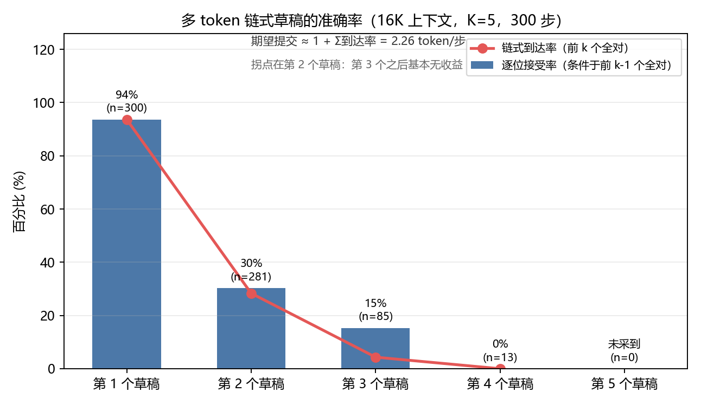

# 在 8 GB 笔记本显卡上跑 9.4B 循环语言模型
### 项目报告：背景、模型、优化历程与前景

> 一页速览
>
> | 指标 | 起点 | 现在 |
> |---|---:|---:|
> | 能否运行 | 跑不起来（需要 >9 GB 显存） | **能**，模型自身 5.4 GB |
> | 16K 上下文生成速度 | 1.7 tok/s（朴素实现） | **20.2 tok/s**（12×） |
> | 上下文 | 2K | **16K 稳定 / 24K 可跑** |
> | 质量 | bf16 基准 | KL 0.146；开思考数学题 8/8 |
> | 硬件 | RTX 4070 Laptop 8 GB / 32 GB RAM / Windows | 同左，无任何硬件改动 |

---

## 一、项目背景

### 1.1 问题

大模型落地的第一道墙不是能力，而是**显存**。本项目要在一台普通笔记本（**8 GB 显存**、32 GB 内存、Windows）上，离线运行一个 **9.4B 参数**的中文/多模态大模型，并且要求：

- **长上下文**：至少 16K token（约 1 万字中文）
- **可交互速度**：20 tok/s 
- **不牺牲质量**

### 1.2 为什么原本跑不起来

| 项目 | 需求 | 8 GB 卡的现实 |
|---|---:|---|
| 权重（bf16） | 约 19 GB | 差 11 GB |
| 权重（4-bit/int8混合） | 约 5.7 GB | 模型量化后只剩 2.9 GB 给 KV、激活、显存池 |
| KV cache（16K，bf16） | 约 0.9 GB | 分层量化，根据敏感度不同采取不同的量化策略 |
| 激活 / 显存池 / CUDA 上下文 | 1–2 GB | — |

而且这个模型比同参数量的普通模型**贵 1.75 倍**：它有 32 个物理层，但其中 24 层要**循环执行两次**，等于每生成一个 token 要做 **56 次层执行**（详见第二节）。所以问题不是"能不能装下"，而是"装下之后还能不能跑得动"。

### 1.3 目标与评价方式

把项目定义成一个**可测量的系统问题**，而不是"调参把速度弄上去"：

1. 在 8 GB 上放下模型 + 16K 上下文；
2. 把生成速度从"不可用"推到"可交互"；
3. **每一步优化都必须有对照实验**，包括失败的尝试（失败原因全部归档）；
4. 质量用两个口径守住：与 bf16 参考的逐位置 KL、以及任务级正确率（8 道数学题）。

---

## 二、模型：SenseNova-Loop-9B

### 2.1 基本信息

| 项 | 值 |
|---|---|
| 参数量 | 9.4B（激活全部参数，非 MoE） |
| 物理层数 | 32 |
| **每 token 层执行次数** | **56**（4 + 24×2 + 4） |
| 注意力结构 | **混合**：8 层 full attention（第 3/7/11/15/19/23/27/31 层）+ 24 层 Gated DeltaNet（线性注意力） |
| 隐藏维度 / 头 | 4096 / 16 查询头、4 KV 头、head_dim 256 |
| 词表 | 248,320 |
| 形态 | **decoder-only** 因果语言模型，外面套一个多模态外壳（视觉编码器 + 文本解码器）；本项目**只用文本解码器**，把视觉塔丢掉（省 0.6 GB） |
| 架构血统 | 文本部分是 Qwen3.5 式解码器（`text_config` 为 `qwen3_5`），tokenizer 为 Qwen2 |

### 2.2 三个"非常规"设计

**（1）层循环（Loop）**

模型不是 56 个不同的层，而是 32 个物理层里的一段（第 4–27 层）被**重复执行**：

```
层 0 1 2 3 │ 4 5 ... 27 │ 28 29 30 31
   └ 单次 ┘   └ 执行 2 次 ┘   └ 单次 ┘
```

效果相当于"用参数换深度"：**深度翻倍，但参数量不变**。代价是计算量变成 1.75 倍、串行依赖变长。

**（2）mHC 路由（multi-head routing）**

在第 4–27 层内部有 2 条并行流，用 Sinkhorn 归一化做路由（原实现每 token 迭代 20 次）。这部分占了早期一步耗时的 25%（28.4 ms），后来用闭式解消掉。

**（3）线性注意力 + 少量全局注意力的混合**

- 24 层是 **Gated DeltaNet**：显存恒定、每 token 代价 O(1)，但"记不住细节"；
- 8 层是标准 full attention：有 KV cache，负责"精确检索"。
- 这种 8:24（约 1:3）的配比是当前工业界的主流折中（Jamba 7:1、MiniMax 6–7:1、Mamba-2-Hybrid 4:1）。

### 2.3 Loop Transformer 与知识蒸馏的区别

这是最容易被混淆的一点。**它们是两个正交的维度**：

| | 知识蒸馏（KD） | 层循环（Loop） |
|---|---|---|
| 做法 | 大模型（教师）教小模型（学生） | 同一批参数反复执行 |
| **省下的是什么** | **参数 / 显存** | **参数 / 显存** |
| **花掉的是什么** | 一次蒸馏的训练成本 | **每 token 的计算与延迟** |
| 推理速度 | 学生模型的速度（1× 深度） | 与循环次数成正比（本项目 1.75×） |
| 能力来源 | 教师的能力被压缩进学生 | 学生的能力被"多用几遍"来放大 |
| 典型问题 | 容量不足、蒸馏损失 | 循环收益递减、训练不稳定 |

一句话：

> **蒸馏是"把大模型压小"，循环是"把小模型用多次"。**
> 蒸馏不增加推理时间，循环一定增加推理时间；两者可以叠加（本项目的模型就是"Qwen3.5 架构 + 循环改造"，同时是 9B 量级的蒸馏产物）。

---

## 三、优化历程

分成两条线：**容量/内存**和**生成速度**。

### 3.1：容量与内存

| # | 措施 | 效果 |
|---|---|---|
| 1 | **离线 NF4 量化权重** | 38 GB（FP32）→ **4.5 GB**；与 bf16 的 KL 0.146 |
| 2 | **丢弃视觉塔** | −0.6 GB（文本任务不需要） |
| 3 | **固定槽位 KV + int8 量化** | 16K 的 KV 从 bf16 约 897 MiB → **456.8 MiB** |
| 4 | **第 2 遍 KV 再压到 int4** | 456.8 → **360.4 MiB**（6 个循环槽位走 4-bit） |
| 5 | **融合 int4 解包内核**（Triton） | 每层反量化 5.6 → **0.32 ms（17×）**，逐位一致——让"int4 不减速"成立 |
| 6 | **MTP 头也量化成 NF4** | −0.35 GB，速度与命中率不变 |
| 7 | **显存守卫 + 定期 empty_cache** | 回收约 1.1 GB 分配器碎片；97% 上限保护 |

**结果**：16K 下模型**自身只占 5.4 GB**（权重 4.5 + KV 0.36 + 激活/图池），整卡 6.8–7.4 GB（含桌面程序约 1.4 GB）。

#### 权重：按层混合精度（4-bit / int8）

除了整体 NF4，项目还实现了**逐层混合精度搜索**：对每一层分别尝试 NF4 与 int8，用 held-out 数据的 KL 选出一套"损失最小、显存可控"的分层方案（脚本 `mixed_search.py`，产出 `mixed_plan_*.json`）。

| 方案 | 与 bf16 的 KL | 16K 下进程显存 | 定位 |
|---|---:|---:|---|
| 全 NF4 | 0.146 | **5.4 GB** | **默认**：余量最大，才放得下 16K + CUDA graph |
| int8 混合（逐层） | **0.078** | **6.6 GB**（整卡 8.59 GB = 100%） | 质量优先：KL 减半，但 16K 没有余量，只在 8K 下稳 |

也就是说 **混合精度能把 KL 减半，代价是约 1.2 GB 显存**。在 8 GB 卡上这两个目标互斥，所以主线用"全 NF4 + 16K"，把 int8 混合保留为质量优先的可选路径（部署路径 B）。

#### KV：按敏感度分层（第 1 遍 int8 / 第 2 遍 int4）

循环结构让 KV 天然分成两组：**第一遍访问的层**和**第二遍访问的同一层**。我们测了同样压缩率下这两组的精度代价：

| 都压到 2-bit 时 | KL |
|---|---:|
| 第一遍 KV | **1.80** |
| 第二遍 KV | **0.33–0.39** |

**第一遍比第二遍敏感约 5 倍**。所以默认不是"均匀压缩"，而是**按敏感度分配比特**：第 1 遍一律 int8、第 2 遍压到 int4。效果是 16K 的 KV 从 **456.8 → 360.4 MiB**，而精度与全 int8 同级。

**这条线的失败尝试**（都记录了原因）：

- KV 压到 2-bit（LoopVQ）：全序列 KL 0.314 尚可，但**序列末段 KL 2.19**，长文会坏；
- 跨层共享 K（−21% KV）：在代码类 prompt 上 15–22 个 token 就分叉；
- 第一遍 KV 也压 4-bit：如上表，第一遍比第二遍敏感约 5 倍，直接崩；
- 权重全 int8（不混合）：KL 好但 16K 下整卡 100%，没有余量跑图。

### 3.2 生成速度

按贡献从大到小：

| # | 措施 | 效果 |
|---|---|---|
| 1 | **启用折叠 GQA 注意力** | 16K 前向 **165.6 → 124.0 ms（−25%）** |
| 2 | **图（CUDA Graph）+ 2-token 投机** | 16K **16.8–17.9 tok/s**（纯贪心 9.8） |
| 3 | **注意力直接读量化 KV** | 16.80 → **20.31 tok/s（+21%）** |
| 4 | **2-token MTP 自投机** | 相对贪心 **×1.4–1.67** |
| 5 | **2×2 Sinkhorn 闭式解** | 一步 125 → **96.7 ms（−23%）** |
| 6 | **int8 小批量 GEMV 修复** | 2-token 验证 **239 → 150 ms** |
| 7 | **融合 RMSNorm + SiLU×up** | 16K 前向 **−5%**，逐位一致 |
| 8 | **固定 KV 缓冲**（不再 `torch.cat`） | 免掉每步拼接，也是显存稳定的前提 |

**最终成绩**（图 + 投机 + 量化 KV）：

| 上下文 | 中位速度 | 稳定性（3 次极差） | 模型显存 |
|---|---:|---:|---:|
| 16K（主场景） | **20.2 tok/s** | 19% | 5.4 GB |
| 24K | 20.6 tok/s（单次） | — | 约 5.6 GB |
| 8K | 23.5 tok/s | 7% | 5.2 GB |

**这条线的失败尝试**（同样全部归档）：

- 3 / 4 / 6-token 投机：比 2-token 慢 12% / 18% / 35%（第 2 位命中率只有 27%）；
  

  *图：链式草稿逐位接受率 93.7% → 30.2% → 15.3% → 0%（n=300/281/85/13），链式到达率 94% → 28% → 4% → 0%，期望提交 1 + Σ = **2.26 token/步**。第 2 个位置就跌到 30%，远低于"多一个草稿"约 75% 的盈亏平衡点，所以 3/4/6-token 只会更慢；2-token 验证是这套模型的最优点。*
- 放宽验证判据（近似接受）：只能捞回 8% 的失配，净收益 3%；
- 推理时把循环跑 4 遍：慢 1.89 倍且输出退化；
- 把 MTP 也捕获进图：单看 MTP 快了 5 ms，但命中率从 15/16 掉到 5/16，净效果 **−35%**；
- 换到 WSL2/Linux：**反而慢 2–6%**，说明瓶颈不在操作系统调度。

### 3.3 可能的项目优化方向（需求更高的循环次数）
kv方向：
1. per-token的kv量化，参考LoopKV: Loop-Aware KV Cache Compression for Serving Looped Transformers https://arxiv.org/abs/2611.04137
2. KV 沿 loop 轴高度冗余，且各 loop 的量化敏感度不同；用向量量化做到 0.5 bit/元素仍可用。 参考LoopVQ https://arxiv.org/abs/2611.05304

生成速度方向：
1. 直接从重复上下文里“抄”出多 token 后缀，用浅层循环深度做早期筛选，加连续递归调度 参考CopyLoop https://arxiv.org/abs/2610.38822
2. 从早期 loop 的预测里草稿、不同循环深度异步推进 参考LoopAhead https://arxiv.org/abs/2610.21594
---

## 四、Loop Transformer 的应用场景与前景

### 4.1 当下最适合的场景

| 场景 | 为什么适合 |
|---|---|
| **显存受限的端侧 / 边缘部署** | 循环用参数换深度：同样能力下参数更少，权重更小 |
| **长上下文、但算力不宽裕** | 配合线性注意力（Gated DeltaNet 等），KV 只来自少数全局层 |
| **私有化 / 离线部署** | 一次加载、无网络依赖；本项目在 8 GB 笔记本上做到 16K / 20 tok/s |
| **推理时算力换能力（test-time compute）** | 循环次数是可以调的"旋钮"：简单问题少跑、难题多跑 |
| **对已有模型做深度改造** | 循环是在现有 checkpoint 上加的，不需要从头训练 |

### 4.2 已知瓶颈

1. **循环的收益递减**：等深度下，一次循环折算的等效参数小于一层真参数；循环越多，边际收益越小；
2. **算力一定变贵**：循环是"省显存不省算力"，在算力受限的场景（如端侧持续生成）并不划算；
3. **注意力仍是刚需**：线性层再深也补不回精确检索，混合比例（3:1–6:1）是硬约束；
4. **训练稳定性**：循环段需要门控、归一化、路由（如 mHC）等技巧才能训起来。

### 4.3 可能的项目优化方向


---


---


